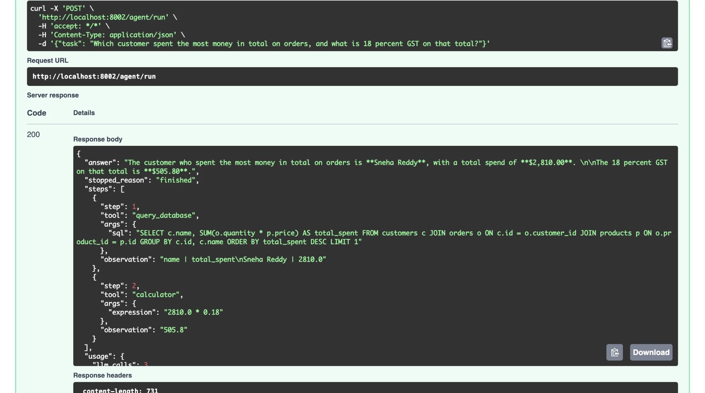

# Toolsmith: Multi-Tool AI Agent

An autonomous agent that solves multi-step tasks by choosing and calling tools in a **think -> act -> observe** loop, exposed as a FastAPI service.

**Stack:** Python, FastAPI, Pydantic, Google Gemini function calling, SQLite, httpx, Docker

## Example run
One request, two tools: the agent queries the database, then uses the calculator. Every step, observation and the token cost are returned:



## Tools
| Tool | What it does |
|---|---|
| `calculator` | Exact arithmetic via a safe AST evaluator (no `eval`) |
| `web_search` | Searches Wikipedia and returns the intro of the top results |
| `query_database` | Read-only SQL `SELECT` against a sample products / customers / orders database |

## The agent loop (`app/agent.py`)
1. Send the task and tool declarations to the model.
2. If the model requests tool calls, run them and feed the results back as observations.
3. Repeat until the model answers, or a guardrail stops the run.

## Guardrails
- **Max steps** (`MAX_STEPS`) and **token budget** (`MAX_TOTAL_TOKENS`)
- **Estimated cost cap** (`MAX_COST_USD`, using the per-token prices you configure)
- **Loop detection**: an identical repeated tool call stops the run
- **Retries** with exponential backoff on rate limits / server errors (`MAX_LLM_RETRIES`)
- **Tool errors become observations**, so the model can fix its input instead of the agent crashing
- **SQL safety**: single `SELECT` only, forbidden-keyword check, and the database is opened read-only; results capped at 50 rows
- Every response reports `stopped_reason` (`finished`, `max_steps`, `token_budget`, `cost_budget`, `repeated_call`, `llm_error`) and token / estimated-cost usage

## Run
```bash
python3 -m venv .venv && source .venv/bin/activate
pip install -r requirements.txt
cp .env.example .env      # add a free key from https://aistudio.google.com/apikey
uvicorn app.main:app --reload
```
Open http://localhost:8000/docs, or:
```bash
curl -X POST localhost:8000/agent/run -H 'content-type: application/json' \
  -d '{"task": "Which customer spent the most on laptops, and what is 18% GST on that total?"}'
```
The response includes the answer, every tool call with its observation, and usage.

## Tests
```bash
pytest
```
The loop is tested with a scripted fake model (multi-step runs, error recovery, every guardrail), so no API key is needed.

## Notes
The agent loop is implemented directly on the Gemini function-calling API rather than through a framework, which keeps every step visible.
